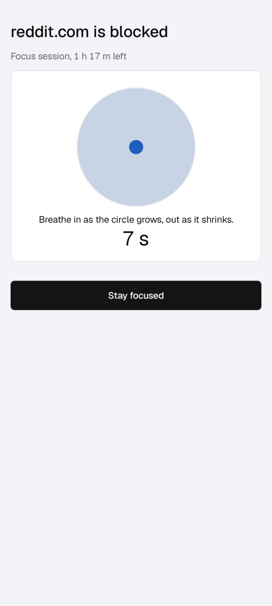
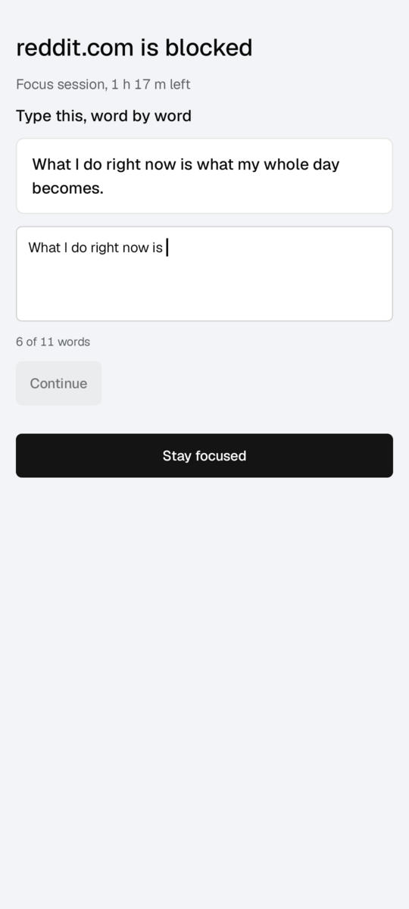
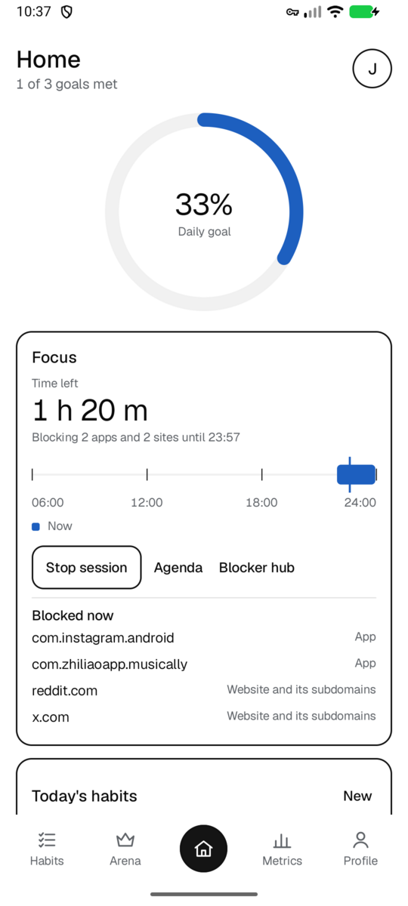
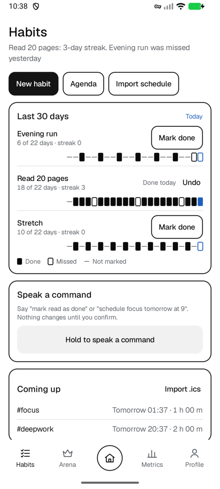

<p align="center">
  
</p>

<h1 align="center">Organiza</h1>

<p align="center">
  <strong>Focus that stays on your devices.</strong><br>
  Open-source app blocking with a mindful pause, on Android, Linux and Windows, with your own database and your own AI key.
</p>

<p align="center">
  <a href="https://github.com/organiza-project/organiza/actions/workflows/ci.yml"></a>
  <a href="LICENSE"></a>
  <a href="https://github.com/organiza-project/organiza/releases"></a>
  
</p>

---

## The problem

Screen-time apps like StayFree or Freedom are built around their own cloud. To count and block
what you do, they collect it: which apps you open, which sites you visit, for how long, and they
keep it in an account on their servers, under terms you do not control. The blocking itself is a
wall: a screen that says no until you find the toggle that says yes.

## What Organiza does instead

| | A typical screen-time app | Organiza |
|---|---|---|
| **Where your usage lives** | Their servers, under their account | An encrypted database on your device (SQLCipher, AES-256), keyed by the system keystore |
| **What leaves the device** | Usage, sites, habits, for their analytics | Nothing by default. Opt-in: sealed challenge results and sealed minutes for your own devices |
| **How a block feels** | A wall, or a button that skips it | The Stoic Pause: a breath, a reason, a phrase typed word by word, then a time limit you choose |
| **Enforcement** | Often an overlay that is easy to dismiss | OS-level: the Android accessibility service and a local DNS filter; on the desktop the blocked app is frozen behind a full-screen pause |
| **AI** | Their model, your data | Bring your own Groq key; prompts are scrubbed on the device first |
| **Backend** | Theirs, required | None, the hosted one, or your own in five minutes with Docker |
| **Source** | Closed | MIT, every line |

### Why local-first matters

What you open, when, and for how long is one of the most revealing records a person makes: it
shows your sleep, your worries, your work and who you talk to. A focus app needs that record to do
its job, which is exactly why it should never leave your hands. If the data is never collected
anywhere, it cannot be sold, leaked, subpoenaed from a vendor or used to train someone's model.

### How telemetry is kept out

- **No collector to switch off.** No analytics, crash-reporting or ad SDK is in any module or
  build type; the dependency list is in [`gradle/libs.versions.toml`](gradle/libs.versions.toml).
- **Logs stay on the device** and never contain URLs, window titles or which apps you use.
- **What may sync is fenced by tests.** Challenge results come only from the `challenge_log`
  table, whose column allow-list a test enforces, and usage leaves only as sealed reports your own
  devices can open ([ADR-0028](ADR.md)).
- **AI sees no names.** Prompts pass an on-device sanitizer, use your own key, and describe the
  hours you get distracted rather than the apps.
- **No account by default.** Every feature but Arena, cross-device limits and the AI copilot works
  offline, with no sign-up.

Organiza never claims to be unbypassable: safe mode, revoking a permission or uninstalling all
work, and losing a permission during a session is recorded. The point is friction you chose, set
when your mind was clear ([ADR-0005](ADR.md), [ADR-0016](ADR.md)).

## Features

<p align="center">
  
  
  
  
</p>

- **The Stoic Pause.** A blocked app gets a breathing pause, a question about what you need it
  for, and one of the app's own phrases to type. Each override on the same day makes the next
  pause longer. Every choice is logged on the device, so you can see when and why focus broke.
- **Focus sessions** block apps, websites and short video feeds, started by hand or from calendar
  events tagged `#focus` or `#deepwork`. Strict sessions ask for longer phrases.
- **Daily limits** lock an app for the rest of the day once its time is used, with or without a
  session. Limits can count all your devices: a two hour limit on Discord is two hours across your
  phone, laptop and PC ([ADR-0028](ADR.md)).
- **Habits as a role-playing game.** Habits, dailies and to-dos earn experience and keep streaks.
- **Arena.** Thirty day challenges with friends that share only signed, encrypted results, never
  usage ([ADR-0011](ADR.md)).
- **AI copilot on your key.** With a free Groq key, the copilot suggests weekly focus blocks and
  habit tips, and turns a timetable photo or a spoken command into sessions. Your hardest hours are
  worked out on the device, with or without it ([ADR-0017](ADR.md)).

## Platform support

| | Android | Linux | Windows |
|---|:---:|:---:|:---:|
| App blocking with the Stoic Pause | ✓ | ✓ | ✓ |
| Usage tracking and daily limits | ✓ | ✓ <sup>1</sup> | ✓ |
| Limits across devices, end-to-end encrypted | ✓ | ✓ | ✓ |
| Focus sessions, calendar import | ✓ | ✓ | ✓ |
| Habits, quests and RPG progress | ✓ | ✓ | ✓ |
| Arena challenges and account sync | ✓ | ✓ | ✓ |
| AI copilot (bring your own Groq key) | ✓ | ✓ | ✓ |
| Voice commands | ✓ | ✓ | ✓ |
| Website blocking | ✓ <sup>2</sup> | | |
| Reels and Shorts feed blocking | ✓ | | |
| Uninstall protection | ✓ | | |
| Tray, start at login | | ✓ | ✓ |

<sup>1</sup> GNOME (through a small shell extension), Hyprland, Sway and X11. KDE on Wayland is not
supported yet.
<sup>2</sup> A local DNS filter on the phone; no traffic leaves through it. The desktop needs a
privileged helper for this, which is not built yet.

Windows support is new in 1.0 ([ADR-0027](ADR.md)). Its Windows-only code runs in a Windows CI job;
reports from real machines are welcome.

## Install

Every installer is on the [releases page](https://github.com/organiza-project/organiza/releases).
No account is needed; everything works offline.

### Android (`.apk`)

Android 8.0 or later. Download `organiza-release.apk` on the phone and open it, or install over USB:

```bash
adb install -r organiza-release.apk
```

Android 13 and later restrict accessibility for apps from outside a store. If **App blocking**
cannot be turned on: **Settings** > **Apps** > **Organiza** > the menu in the corner > **Allow
restricted settings**. Onboarding walks you through the rest. Install errors and what they mean
are in [`TROUBLESHOOTING.md`](TROUBLESHOOTING.md), with what to do when Play Protect blocks the
install.

### Linux (`.deb`)

Ubuntu, Debian and their derivatives, on GNOME, Hyprland, Sway or an X11 desktop.

```bash
sudo apt install ./organiza_1.0.0-1_amd64.deb
```

Open Organiza from the app grid and allow usage tracking. On GNOME this installs a small shell
extension, which starts after you log out and back in once. The tray icon on GNOME needs the
AppIndicator extension, which Ubuntu includes.

### Windows (`.msi`)

Windows 11. Run `Organiza-1.0.0.msi`; it installs for your user only, so no administrator is
needed. The installer is not code-signed yet, so SmartScreen may ask: choose **More info** >
**Run anyway**. Allow usage tracking and, if you like, starting at sign-in.

### From source

```bash
git clone https://github.com/organiza-project/organiza.git
cd organiza
./gradlew :app:desktop:run                 # the desktop app on Linux or Windows
./gradlew :app:android:assembleDebug       # an Android debug APK
```

## Bring your own key, bring your own database

**AI (BYOK).** The copilot uses [Groq](https://console.groq.com/keys), whose free tier covers it.
Paste your key under **Profile** > **Key settings**. It is stored in the platform keystore
(Android Keystore, the Linux login keyring, or DPAPI on Windows), never in plain text or a log. Every
prompt passes an on-device sanitizer that replaces links, email addresses, phone numbers and any
names you mark as private before it is sent, and the copilot works from the hours you get
distracted, never from which apps ([ADR-0009](ADR.md), [ADR-0017](ADR.md)).

**Database (BYODB).** A backend is optional. It adds an account, Arena challenges and limits
across devices, and it only ever holds accounts and padded ciphertext. Choose under **Profile** >
**Where Arena syncs**:

- **This device only.** Nothing leaves the device.
- **Organiza hosted.** Builds made with a hosted project baked in offer it.
- **My own Supabase.** Enter a project URL and its anon key. Run one on supabase.com with
  [`docs/supabase-setup.md`](docs/supabase-setup.md), or on your own machine in about five minutes
  with Docker or Portainer: [`docs/SELF_HOSTING.md`](docs/SELF_HOSTING.md).

Hosted and self-hosted are the same Supabase API at a different address; the app does not treat
them differently ([ADR-0015](ADR.md)).

## How it works

Organiza is Kotlin Multiplatform with Compose Multiplatform: every screen and the whole app core
are shared, and each platform adds a thin layer that talks to its OS ([ADR-0023](ADR.md),
[ADR-0025](ADR.md)).

```
core/        Plain Kotlin, tested on the JVM: block engine, friction, scheduler, storage,
             calendar, AI sanitizer and client, voice, Arena crypto, sync, screen models
app/shared   Compose UI and the app core (OrganizaCore), shared by every platform
app/android  Accessibility service, local DNS filter, device admin, Keystore, SQLCipher
app/desktop  Focus sources (GNOME, Hyprland, Sway, X11, Windows), the process freezer,
             tray, autostart, keyring or DPAPI, encrypted SQLite
supabase/    The backend schema, and a Docker stack to self-host it
site/        The landing page
```

| On Android | On the desktop |
|---|---|
| The accessibility service sees which app is open, reads browser address bars and draws the pause | A focus source reports the app in front: a GNOME Shell extension, Hyprland or Sway IPC, X11 properties, or `User32` on Windows |
| A local VPN answers no DNS for blocked sites | The pause is a full-screen window; the blocked app is stopped (SIGSTOP, or `NtSuspendProcess` on Windows) and continued when you choose, with its work kept |
| SQLCipher, keyed by Android Keystore | Encrypted SQLite, keyed by the login keyring or DPAPI |

Every decision and its reasons are in [`ADR.md`](ADR.md).

## Contributing

Contributions are welcome. Read [`CONTRIBUTING.md`](CONTRIBUTING.md) for the layout and the
ground rules; in short:

1. **Set up.** JDK 17 (a full JDK, not a JRE) and the Android SDK, platform 36.
2. **Build and test.**
   ```bash
   ./gradlew test                                     # every JVM test; CI runs this with assembleDebug
   ./gradlew :core:enforcement:test --tests '*BlockEngineTest*'
   ./gradlew :app:android:connectedDebugAndroidTest   # Compose UI tests, on an emulator
   scripts/verify-android.sh                          # end-to-end enforcement checks, on an emulator
   ```
3. **Write the test first.** Watch it fail, then make it pass. Core tests use the hand-written fakes
   in `core/testing`, never mocks.
4. **Record decisions.** A new module, dependency, data model, crypto primitive or sync protocol
   gets an ADR in `ADR.md` in the same pull request.
5. **Keep privacy intact.** No analytics, crash reporting or ad SDKs; logs never contain URLs,
   window titles or app usage; keys stay in the platform keystore ([`.claude/rules`](.claude/rules)).
6. **Open a pull request** against `main` with Conventional Commit messages
   (`feat(enforcement): ...`, `fix(sync): ...`). CI must be green.

## Documentation

- [`ADR.md`](ADR.md): every architectural decision and its reasons
- [`CONTRIBUTING.md`](CONTRIBUTING.md): building, testing and proposing changes
- [`docs/SELF_HOSTING.md`](docs/SELF_HOSTING.md): your own backend with Docker or Portainer
- [`docs/supabase-setup.md`](docs/supabase-setup.md): the backend schema, authentication settings and keys
- [`docs/schema.md`](docs/schema.md): the local database
- [`TROUBLESHOOTING.md`](TROUBLESHOOTING.md): Play Protect, restricted settings, install errors, tracking and self-hosting problems
- [`docs/install.md`](docs/install.md): installing an APK over USB
- [`docs/screenshots`](docs/screenshots): every screen

## License

[MIT](LICENSE). Geist is bundled under the SIL Open Font License ([`docs/licenses`](docs/licenses)).
