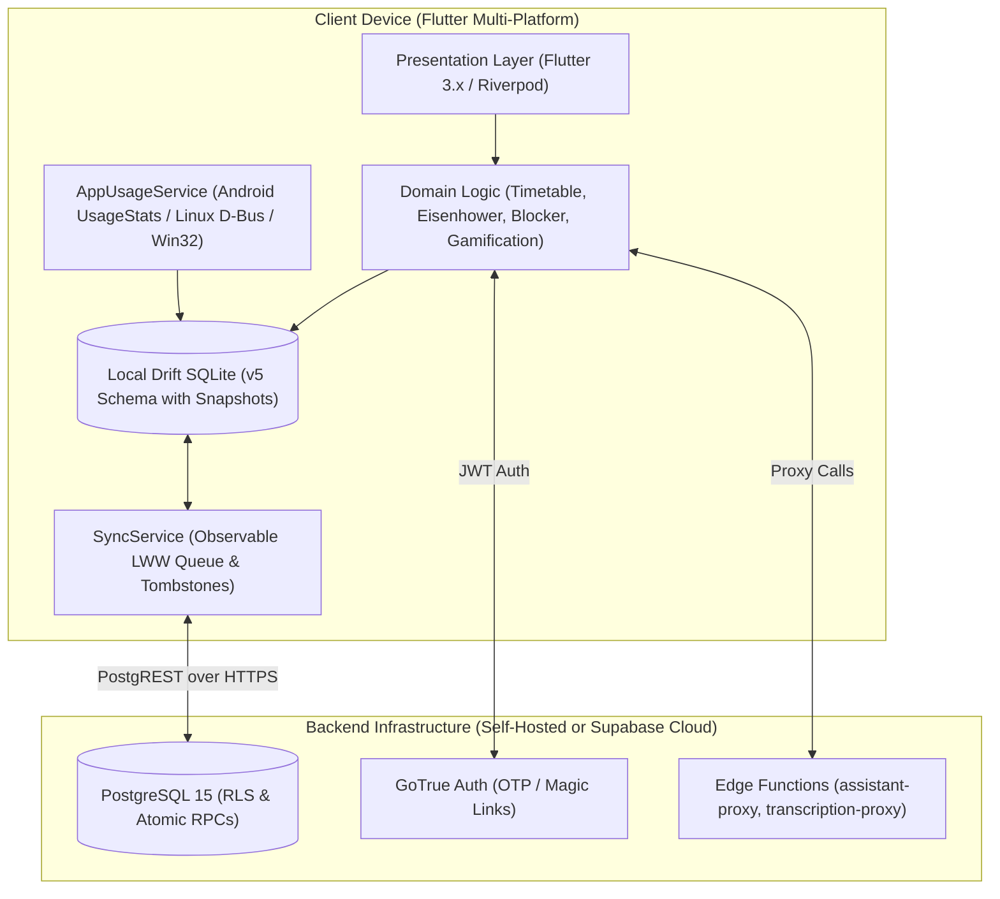

# Organiza

<div align="center">
  <h3>Offline-First Productivity, Focus Tracking & Stoic Habit Architecture</h3>
  <p>Master time, curb algorithmic distractions, and forge personal discipline across Mobile and Desktop.</p>
</div>

---

## 🌟 Highlights & Philosophy

- **Local-First Authority**: Organiza stores tasks, schedules, journals, and screen-time analytics in an embedded, pre-migration-backed SQLite database powered by [Drift](https://drift.simonbinder.eu/). The client operates with 100% functionality completely offline.
- **Unprivileged Desktop Tracking**: Monitors foreground window focus on Linux (X11 & GNOME Wayland D-Bus) and Windows (Win32) without requiring root/administrator access or invasive kernel drivers.
- **Strict Server Authority**: Gamification rewards, level-up milestones, star balances, and cosmetic shop purchases are secured via PostgreSQL Row Level Security (RLS) and atomic `SECURITY DEFINER` stored procedures. Clients cannot arbitrarily forge balances or progress.
- **Reciprocal Duels & Social Challenges**: Challenge friends to deep-work duels with star wagers. Wagers are held in server-side escrow and settled once with strict idempotency and zero recursive policy evaluation.
- **Distraction Blocker with Stoic Friction**: Enforces daily app caps and scheduled curfews. Bypassing an active block requires manual typing of reflective Stoic essays, breaking impulsive reward loops.
- **Zero Cloud Lock-in**: Full self-hosting support with version-controlled migrations, deterministic seeds, and Edge Function proxies.

---

## 🏛 Architecture



---

## 💻 Platform Support & Status

| Platform | Tracking Engine | Packaging Track | Minimum Version |
|---|---|---|---|
| **Android** | Android `UsageStatsManager` | Signed AAB (Play Store) & APK | Android 8.0+ (API 26+) |
| **Linux** | X11 (`xdotool`) & GNOME Wayland D-Bus | AppImage, `.deb`, portable tarball | Ubuntu 20.04+, Debian 11+ |
| **Windows** | Win32 `GetForegroundWindow` / PID Image | Inno Setup (`.exe`) / MSIX | Windows 10 (1809+) & 11 |
| **iOS** | Manual Focus & Timetable Sessions | TestFlight Archive | iOS 15.0+ |

---

## 🚀 Quick Start (Development Setup)

### Prerequisites
- [Flutter SDK](https://docs.flutter.dev/get-started/install) `>= 3.24.0`
- [Dart SDK](https://dart.dev/get-dart) `>= 3.5.0`
- Android Studio / Xcode / Linux desktop toolchains as required.

### 1. Clone & Install
```bash
git clone https://github.com/organiza-project/organiza.git
cd organiza
flutter pub get
```

### 2. Code Generation (Drift & Riverpod)
```bash
dart run build_runner build --delete-conflicting-outputs
```

### 3. Run Locally (Offline Mode)
```bash
flutter run
```

### 4. Connect to Supabase Backend
To connect the application to a cloud or self-hosted Supabase instance:
```bash
flutter run \
  --dart-define=SUPABASE_URL=https://your-project.supabase.co \
  --dart-define=SUPABASE_ANON_KEY=eyJhbGciOi...
```

For complete self-hosting instructions, see [SELF_HOSTING.md](SELF_HOSTING.md).

---

## 🧪 Testing & Verification

Run the full automated test suite (migrations, services, auth OTP, rewards, and UI accessibility):
```bash
# Run static code analysis
flutter analyze --fatal-infos

# Run complete unit and widget test suite
flutter test
```

### Database & RLS Tests
Run PostgreSQL test suites against your local or test Supabase instance:
```bash
psql "$DATABASE_URL" -f supabase/tests/rls.sql
psql "$DATABASE_URL" -f supabase/tests/rewards.sql
psql "$DATABASE_URL" -f supabase/tests/challenges.sql
```

---

## 📦 Building Releases

### Android
```bash
flutter build apk --release
flutter build appbundle --release
```

### Linux
```bash
./scripts/package_linux.sh
```

### Windows
```bash
flutter build windows --release
```

### Generate Software Bill of Materials (SBOM) & Checksums
```bash
./scripts/generate_sbom.sh dist/organiza-sbom.json
./scripts/generate_checksums.sh dist
```

---

## 🔒 Privacy & Security

- **Strict Local Encryption**: Usage logs, private reflections, and daily journal content reside on your device.
- **Privacy-Preserving Crash Reporting**: The integrated `CrashReporter` automatically strips email addresses, JWT tokens, Bearer headers, and user directories before logging. Telemetry is opt-in only.
- **Zero Third-Party Advertising**: Organiza contains zero ad networks, trackers, or commercial monetization SDKs.

---

## 📄 License

This project is licensed under the [MIT License](LICENSE).